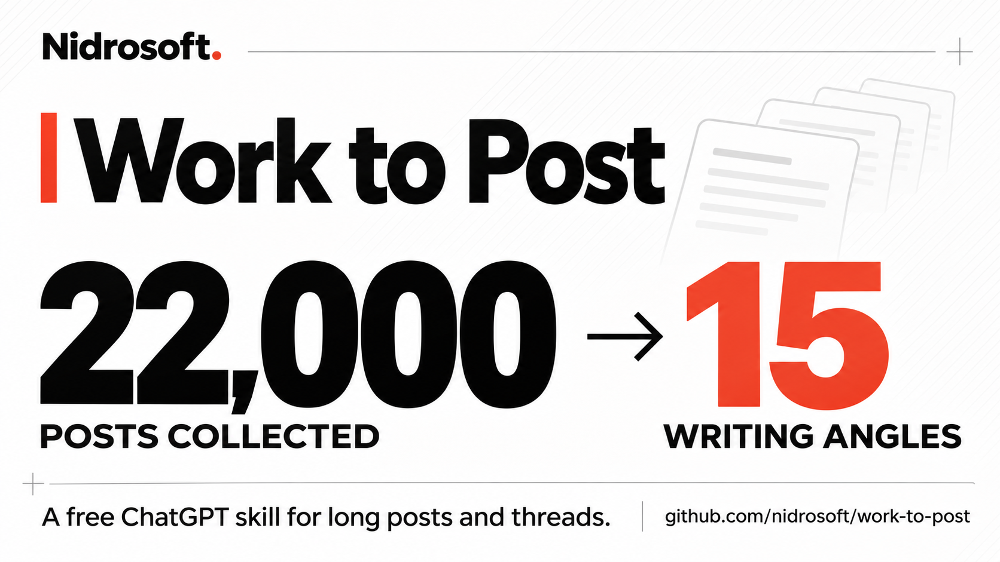

# Work to Post for ChatGPT



Turn work, observations, and research into useful X posts for client projects or personal consulting, contract, and employment opportunities. Created by **Cyriac Zeh / Nidrosoft**. Version **0.1.0-beta.2**, released under the [MIT license](LICENSE).

The framework has 15 editorial angles, fill-in templates, Premium long-post and thread examples, a posting rhythm, and an embedded editing pass adapted from Peter Yang's No AI Slop. It serves engineers, designers, founders, AI practitioners, and consultants. Each person supplies their own experience and evidence.

The process is **profile → reader and outcome → material → angle → draft → editorial pass → fact and length check → review → learn**. Publishing remains the user's decision.

## Start with ChatGPT

1. Download and unzip [the ChatGPT kit](https://github.com/nidrosoft/work-to-post/releases/download/v0.1.0-beta.2/work-to-post-chatgpt.zip).
2. Upload [WORK-TO-POST.md](WORK-TO-POST.md) to a ChatGPT conversation. It is the complete guide; no separate writing skill or API is required.
3. Supply your profile and rough notes, or fill in the templates in the ZIP.
4. Send this request:

> Use Work to Post in Draft mode. Use my profile and notes below. Choose the strongest supported angle for my intended reader. Give me one post, its supporting material, and any facts or assets still needed. Keep client projects and personal offers separate. Do not invent results.

For repeat use, add the guide and your completed profile to a ChatGPT project, then copy [PROJECT-INSTRUCTIONS.txt](PROJECT-INSTRUCTIONS.txt) into its instructions. This uses uploaded documents as context; it does not install a native ChatGPT plugin. See the [official project guidance](https://learn.chatgpt.com/docs/projects).

Start with these four lines. More detail is optional.

```text
What happened, what I built, or what I noticed:
Who should care, and why:
What I can support with facts, examples, or an artifact:
What I want the reader to do or understand:
```

## What you get back

Normally: one selected angle and reader, clean post copy, supporting material, and a short readiness note. The editing pass runs quietly on every draft and revision. It preserves facts, technical terms, uncertainty, and voice. It does not append a change report or claim to detect AI authorship.

Ask for copy only when you want only the post. Ask for Explore mode to compare up to three supported angles, Plan mode for a sequence, Review mode for an existing draft, or Learn mode to interpret your results.

Supply your X account capability and preferred format once. The assistant can write short posts, longer Premium posts, or threads according to the material. It asks about account capability only when missing and relevant. A private preview can use fully filled illustrative stories when explicitly requested, with one note outside the copy; those examples do not become facts about your work.

## Choose the material before the angle

| Choice | What it answers | Example |
|---|---|---|
| Profile | Who is speaking? | A backend engineer |
| Outcome | What opportunity matters? | A personal engineering contract |
| Reader | Who should recognize the value? | An engineering lead |
| Topic | What area of knowledge? | Reliability |
| Use case | What concrete situation? | An import interrupted by a browser disconnect |
| Angle | What useful contribution? | A decision rule for background jobs |
| Format | How will readers encounter it? | A short post with an optional diagram |
| Evidence | What supports the claim? | Conditional reasoning or an actual implementation |

CLIENTS tracks buyers engaging a business or independent practice for a scoped service. OFFERS tracks teams approaching the person for an embedded assignment, contract, or employment role. Score and attribute them separately. Reach alone does not establish either outcome.

## Guide and templates

| Resource | Use |
|---|---|
| [Start here](START-HERE.md) | Instructions for the unzipped ChatGPT kit |
| [Complete guide](WORK-TO-POST.md) | Upload this file with your own profile |
| [Profile](work-to-post/assets/profile.md) | Stable context to fill once |
| [Post brief](work-to-post/assets/post-brief.md) | Material for a new draft |
| [15 angles](work-to-post/references/angles.md) | Structures, templates, evidence requirements, and reader fit |
| [Editorial pass](work-to-post/references/editorial.md) | Embedded No AI Slop adaptation |
| [Posting rhythm](work-to-post/references/rhythm.md) | Capture, draft, publish, and review |
| [Results log](work-to-post/assets/review-log.md) | Keep client and personal opportunities separate |
| [Examples](work-to-post/references/examples.md) | Different professional contexts, clearly labeled |
| [Try it](TRY-IT.md) | Five prompts to test in your own ChatGPT account |
| [Validation](VALIDATION.md) | Checks, observed results, and testing limits |

## Release scope

This is the ChatGPT beta package. No Claude distribution is included. The 15 angles are writing choices, not a promise of virality, clients, or offers. Try the guide with your own material and record actual outcomes. See [research limits](work-to-post/references/research.md).

Keep completed profiles, prospect records, and confidential client work private. The ZIP uses an explicit file list; it excludes local pilot records and arbitrary files added beside the source.

## Maintain the package

Edit the canonical modules inside `work-to-post`, then rebuild and test:

```sh
python3 scripts/package.py
python3 -m unittest discover -s tests -p 'test_*.py'
```

The builder uses Python's standard library and [release-manifest.json](release-manifest.json). It creates the all-in-one guide and one ChatGPT ZIP. It does not install a skill, access the network, or publish anything.

The original framework is copyright 2026 Cyriac Zeh under MIT. The embedded editorial adaptation retains Peter Yang's separate MIT notice in [THIRD_PARTY_NOTICES.md](THIRD_PARTY_NOTICES.md), the standalone guide, and the ZIP. See [AUTHORS.md](AUTHORS.md). ChatGPT is an OpenAI product; this is an independent framework.
